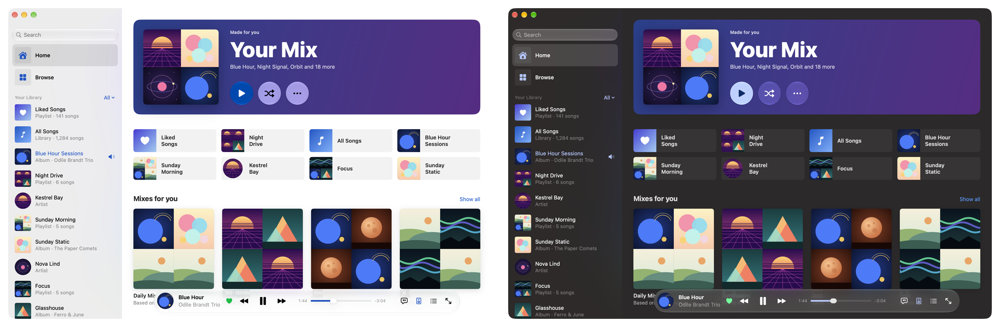
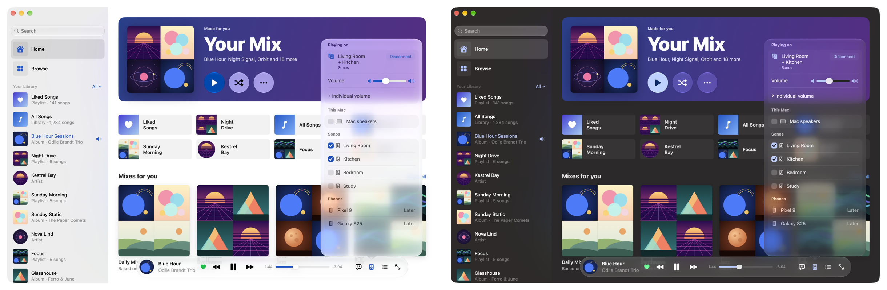
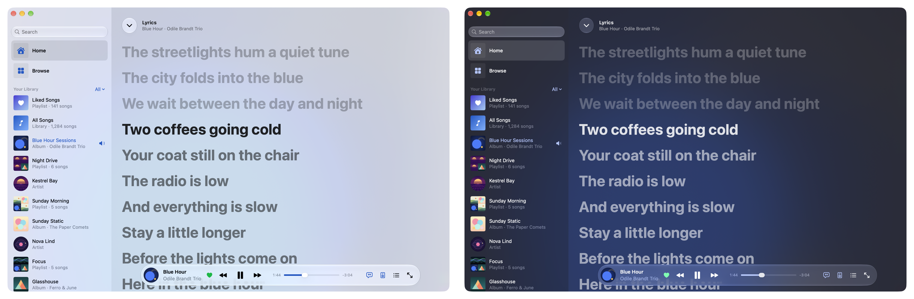

# PixelPlayer for Mac

[](https://github.com/Marukiee/PixelPlayer-Mac/releases/latest)
[](LICENSE)


English | [Nederlands](README.nl.md)

**Your Navidrome library and the music on your Mac in one native player.** PixelPlayer for Mac works the way PixelPlayer does on Android: a song you have on the Mac plays from the Mac, likes and listens stay in step with your server, and the music can move to your Sonos speakers or your phone.

## Screenshots





## What it does

- **One library:** your Navidrome server and a music folder on the Mac together. When a song is in both, the Mac plays its own file.
- **Likes and listens:** a heart here is a star on the server and the other way round, with the same rules as PixelPlayer on Android. Listens count on the server once you heard half a song or four minutes.
- **Sonos:** pick rooms in Connect, group them and set the volume per room. The Mac keeps the queue.
- **Your phone:** play on a phone with PixelPlayer, paired over Bluetooth. The phone plays its own copy of each song and the Mac follows it.
- **Native:** a floating glass player, a queue column, lyrics across the window, a full screen player, the menu bar and media keys.

## Install

1. Download `PixelPlayer-v<version>-macOS.zip` from the [latest release](https://github.com/Marukiee/PixelPlayer-Mac/releases/latest).
2. Open the zip and move PixelPlayer to Applications.
3. The first time, right click the app and choose Open. macOS asks because the app is signed with a certificate of its own, not by Apple.
4. In Settings › Sources, choose your music folder and log in to Navidrome.

After that the app updates itself: a card at the top of the window shows a new version, and one click installs it.

## Build

Needs macOS 26 and the Command Line Tools.

```bash
swift run PixelPlayerChecks
./scripts/build-app.sh
open "dist.noindex/PixelPlayer Dev.app"
```

The development build never updates itself. Test tools for the Sonos and phone parts are in `tools/`.

## License

AGPL-3.0, see [LICENSE](LICENSE). Made by Mark Maakt Media.
