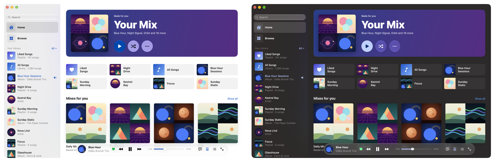
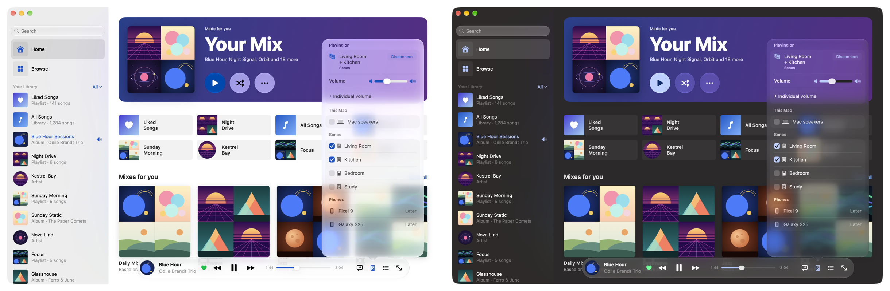
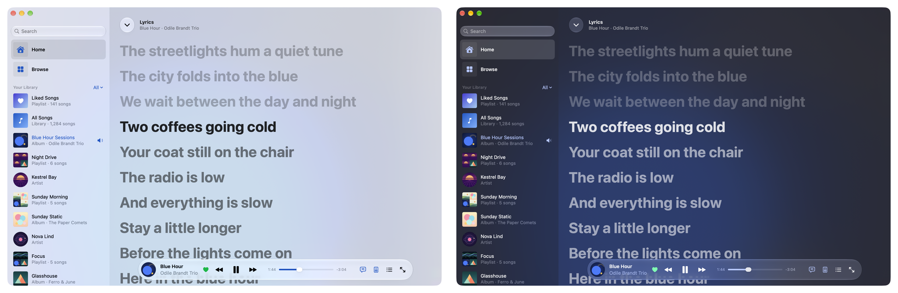

# PixelPlayer voor Mac

[](https://github.com/Marukiee/PixelPlayer-Mac/releases/latest)
[](LICENSE)


[English](README.md) | Nederlands

**Je Navidrome-bibliotheek en de muziek op je Mac in een native speler.** PixelPlayer voor Mac werkt zoals PixelPlayer op Android: een nummer dat op de Mac staat speelt van de Mac, likes en luisterbeurten lopen gelijk met je server, en de muziek kan naar je Sonos-speakers of je telefoon.

## Screenshots





## Wat het doet

- **Een bibliotheek:** je Navidrome-server en een muziekmap op de Mac samen. Staat een nummer op allebei, dan speelt de Mac zijn eigen bestand.
- **Likes en luisterbeurten:** een hartje hier is een ster op de server en andersom, met dezelfde regels als PixelPlayer op Android. Een luisterbeurt telt op de server zodra je de helft van een nummer of vier minuten hebt gehoord.
- **Sonos:** kies kamers in Connect, groepeer ze en zet het volume per kamer. De Mac houdt de wachtrij bij.
- **Je telefoon:** speel af op een telefoon met PixelPlayer, gekoppeld via Bluetooth. De telefoon speelt zijn eigen kopie van elk nummer en de Mac volgt hem.
- **Native:** een zwevende glazen speler, een wachtrijkolom, songtekst over het hele venster, een speler op volledig scherm, de menubalk en de mediatoetsen.

## Installeren

1. Download `PixelPlayer-v<versie>-macOS.zip` bij de [nieuwste release](https://github.com/Marukiee/PixelPlayer-Mac/releases/latest).
2. Open de zip en zet PixelPlayer in Programma's.
3. De eerste keer: klik met rechts op de app en kies Open. macOS vraagt dit omdat de app met een eigen certificaat is ondertekend en niet door Apple.
4. Kies in Instellingen › Sources je muziekmap en log in bij Navidrome.

Daarna werkt de app zichzelf bij: een kaart bovenin het venster meldt een nieuwe versie, en met een klik is hij geinstalleerd.

## Bouwen

Nodig: macOS 26 en de Command Line Tools.

```bash
swift run PixelPlayerChecks
./scripts/build-app.sh
open "dist/PixelPlayer Dev.app"
```

De ontwikkelversie werkt zichzelf nooit bij. Testhulpmiddelen voor Sonos en de telefoon staan in `tools/`.

## Licentie

AGPL-3.0, zie [LICENSE](LICENSE). Gemaakt door Mark Maakt Media.
